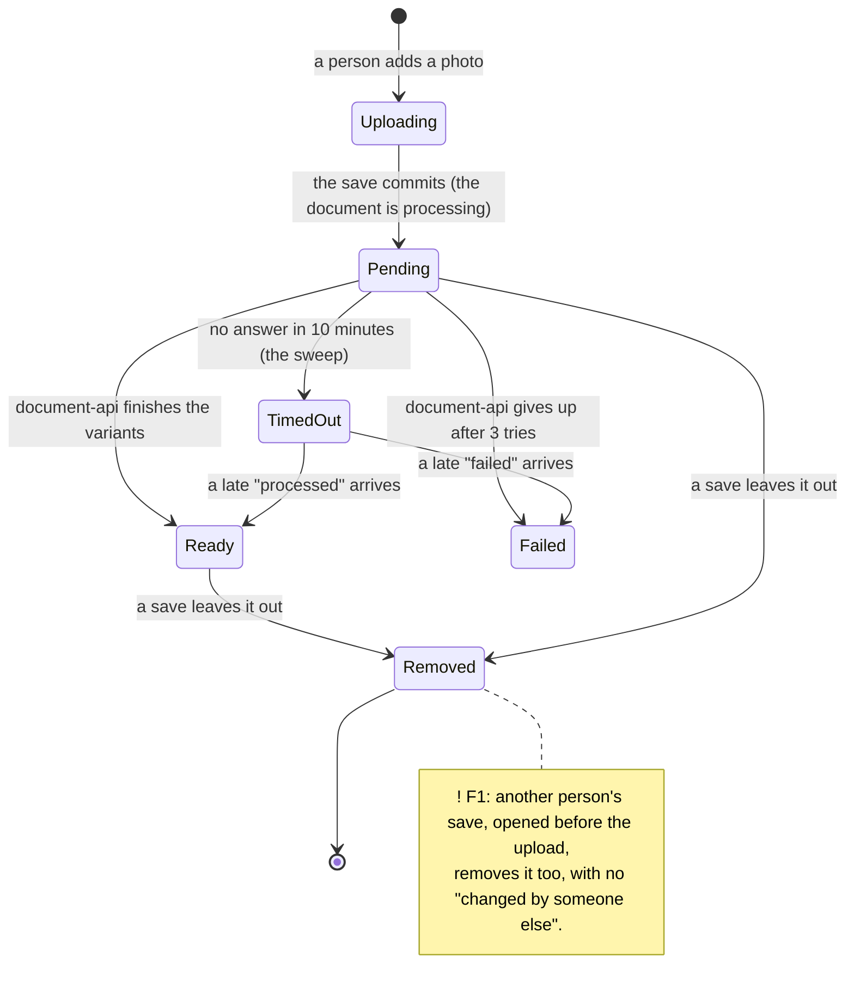
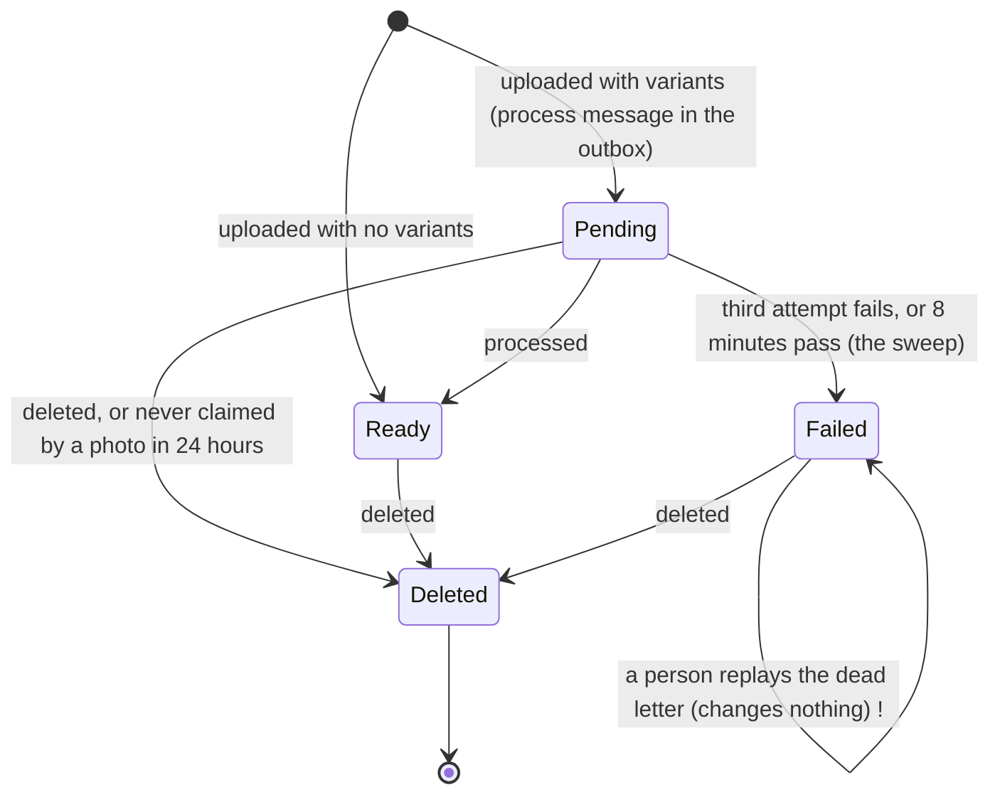
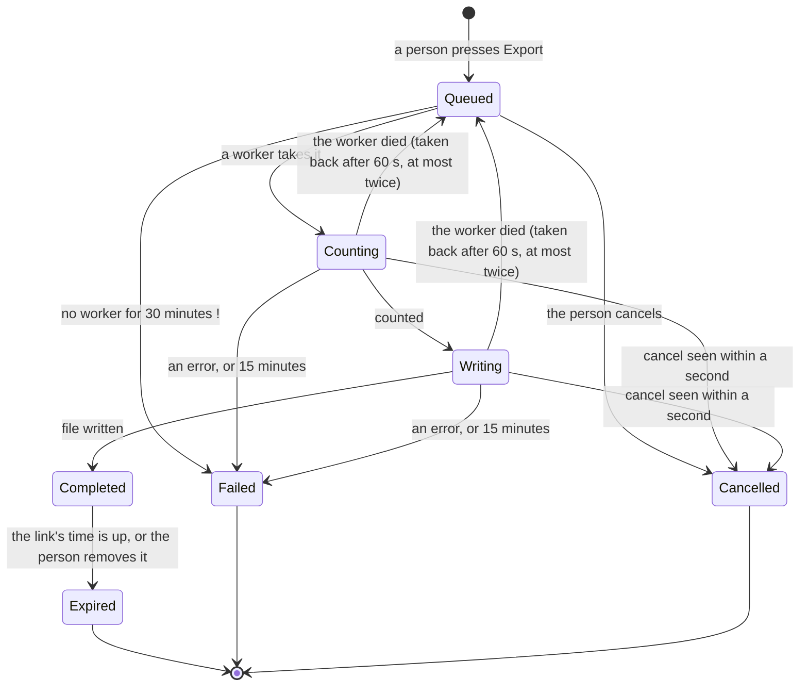
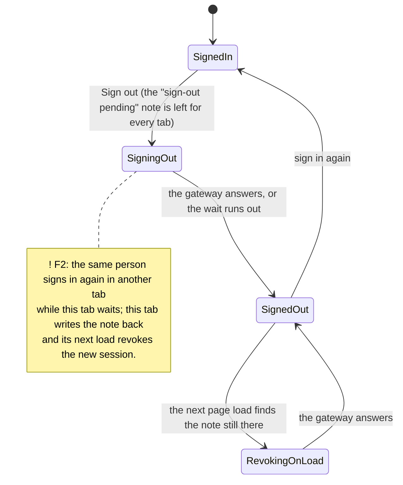

# Implicit state machines: the whole-repository sweep

**Status:** Open

**Last sweep:** 2026-11-09, branch `final` at `378a76e`, all four areas (`/find-state-machines`). First sweep: nothing
was recorded before. Each area was read by its own read-only searcher against `.claude/agents/state-reviewer.md`
sections 1 to 7; nothing blocking was found. A finding marked `checked` was confirmed by reading the code it cites;
`inferred` rests on reading part of the path. The worst one (F1) was opened and read again before writing.

## The main machines, as charts

Arrows say what a person or the system does, in their words; a state marked `!` has a finding against it.

### A part's photo (dealership-api and document-api together)

### A document in document-api

`!` F3, F4: a replayed message that fails again is dropped by RabbitMQ; and a replay cannot revive a Failed document.

### An export job

`!` F7: the 30 minutes count from when the job was made, not from when it last became Queued.

### Signing out across tabs (the web app with the gateway)

## Findings, worst first

- [ ] **F1** should-fix · checked · dealership-api ·
      `business-logic/handlers/parts/upload-photo/upload-part-photo.command-handler.ts` (no version change) with
      `business-logic/handlers/parts/update/update-part.command-handler.ts:84-110,138-170` · part version
  - **A photo uploaded on its own is deleted by another person's save, without a 412.** The upload never bumps
    `parts.version`; the save removes "the photos the part has now, less the ones the form kept".
  - Scenario: A opens a part at version 5 with P1. B uploads P2 (the version stays 5). A saves with `photos: [P1]`
    and If-Match "5": the check passes, P2 is soft-deleted and its document deleted.
  - Fix: bump the part's version in the upload's transaction. Test: an upload between a read and a save gets 412.
- [ ] **F2** should-fix · inferred · web · `web/app/core/kernel/authKernel.ts:74,102-105,132-134,175-177` · sign-out
  - Tab A signs out, the gateway is slow; the same person signs in again in tab B (clears the shared note); A ignores
    a sign-in by the same person, then writes the note back and leaves; A's next load revokes B's new session.
  - Fix: any `signed-in` message while this tab is signing out moves its generation. Test: authKernel, a same-user
    sign-in arriving before a slow revoke answers `false`; the note stays clear.
- [ ] **F3** should-fix · checked · document-api · `DeadLetterReplay.cs:25`, `RabbitMqConnection.cs:69-71`,
      `ProcessDocumentConsumer.cs:143,170` · dead letters
  - A replayed message keeps the queue's routing key; after three more failures the dead-letter exchange routes by
    that key, which the dead-letter queue is not bound to, and RabbitMQ drops it. A replayed `document.unclaimed`
    that fails again leaves its document for good.
  - Fix: bind the dead-letter queue to the process queue's key too, or replay through `acme.documents` with the
    message's type. Test: replay, fail three times, the message is back in the dead-letter queue.
- [ ] **F4** should-fix · checked · document-api · `ProcessDocumentConsumer.cs:113,130-143`,
      `ProcessDocumentCommandHandler.cs:53` · document and its delivery
  - The consumer marks the document Failed (final) before dead-lettering; Process skips anything not Pending, so a
    replay only acknowledges no-ops. An outage longer than the retries (2 s + 4 s) fails every document in flight for
    good, while a warning every minute sends a person to a replay that changes nothing.
  - Fix: choose which is final: acknowledge once Failed is saved (dead-letter only when that save fails), or retry
    through a delay queue longer than an outage before failing, as dealership-api does (5 × 5 s).
- [ ] **F5** should-fix · inferred · web and dealership-api · `web/app/pages/customers/queries/customerQueries.ts:25`,
      `web/app/pages/parts/queries/partQueries.ts:22` · creating a customer or part
  - Creates carry no idempotency key: a save whose answer is lost (a timeout after the commit) is saved twice when the
    person presses Save again (a second customer; a 409 for the part number). Exports already do this right.
  - Fix: ACME-125 (one key per submission, the service replays the stored answer).
- [ ] **F6** should-fix · inferred · gateway · `GetAccessTokenCommandHandler.cs:73,110` · session renewal lease
  - The lease UPDATE runs with the browser's cancellation: an abort after Postgres commits it, before the answer is
    read, leaves the lease held 15 s with no renewal behind it; requests with an expired token wait, then 503.
  - Fix: `CancellationToken.None` for the lease, as the renewal already uses. Test: cancel after the lease is taken;
    `renewing_until` is null.
- [ ] **F7** should-fix · checked · dealership-api · `business-logic/exports/export-queue.ts:102-113` with
      `export-worker.ts:231-235` · export job
  - "No worker" fails a job 30 minutes after `created_at`, not after it became Queued: a job that waited in a long
    line, or was taken back from a dead worker, is failed while workers run, and the log says "is one running?".
  - Fix: a `queued_since` set on insert and on requeue. Test: a requeued job older than 30 minutes is not failed.
- [ ] **F8** should-fix · inferred · dealership-api · `update-part.command-handler.ts:196-200,245-255`,
      `upload-part-photo.command-handler.ts:75` · documents of removed photos
  - The document of a removed photo is deleted after the commit, best effort, with the request's cancellation: a
    closed tab or a failure leaves it in document-api for good, with a log line only.
  - Fix: on a failed delete, record the document as unclaimed (the 24-hour sweep then sends `document.unclaimed`).
- [ ] **F9** should-fix · checked (web) / inferred (reachable) · web · `core/kernel/locationKernel.ts:78-79`,
      `core/middleware/authClientMiddleware.ts:15-16`, `pages/SignIn.tsx:35-36` · location
  - A signed-in user with no locations is sent to /sign-in, which sends a signed-in user to `/`: a loop with no exit.
  - Fix: a `no-location` state with its own page.
- [ ] **F10** should-fix · checked · web · `pages/parts/formatters/photoProcessing.ts:10-21`, `pages/parts/hooks/usePart.ts:12`
      · photo on screen
  - The page stops asking after 2 minutes; the server's way out of Pending is 10 minutes. A photo that finishes in
    between shows "taking long" until a reload, and the module-level first-seen time never polls it again in the tab.
  - Fix: ask more slowly until the server's deadline, or offer "check again"; forget a photo once it is not pending.
- [ ] **F11** should-fix · checked · web · `core/kernel/exportKernel.ts:161-166,189-198`, `ExportCard.tsx:132` · export card
  - Dismissing a running export cancels it without waiting or catching: a failed cancel leaves it running on the
    server, gone from the screen, back on the next reload; a cancel on a stalled card is never shown.
  - Fix: remove the card only when the cancel answers, or keep it with the problem shown.
- [ ] **F12** should-fix · inferred · dealership-api · `export-queue.ts:229-238` with `unit-of-work.factory.ts:107-111` ·
      export progress stream
  - The request's one connection wait is spent by its first poll: every later poll waits 100 ms at most, so on a busy
    morning a followed export's stream dies "busy" while the export goes on.
  - Fix: each poll its own wait. Test: a poll after the list's wait still waits the full wait.
- [ ] **F13** should-fix · checked · document-api · `DocumentsDbContext.cs:33,39-41` · document status
  - `status` has no CHECK; the allowed moves are repeated in each handler; nothing holds Failed ⇔ a reason.
  - Fix: a CHECK on the values and pairs, and `Document.MarkReady` / `MarkFailed` holding the Pending guard.
- [ ] **F14** should-fix · checked · document-api · `tests/Acme.Documents.Tests/Handlers/Documents/*` · tests
  - Untested: Fail, the consumer's retry and give-up, the relay, replay, a duplicate process message, Process on a
    Failed document, the sweep racing Process. F3 is the loss such a test would have caught.
- [ ] **F15** should-fix · inferred · document-api · `OutboxRelay.cs:59-63` · outbox
  - Rows are read without a claim: two document-api instances (a rolling deploy) publish every row twice. Harmless
    today (one instance; dealership-api drops duplicates by message id). Fix: `FOR UPDATE SKIP LOCKED`.

Notes (no box): a soft delete of a photo has no `NOT is_deleted` guard; an export taken back is not checked for a
cancel requested in between; expiry and old rows are swept only by a worker; the gateway logs "another renewal saved
first" when the row was deleted by a sign-out; the gateway decides "due" on its clock but leases on Postgres's;
identity's key ring is not used as a fallback when its database is down; a sign-in throttle entry can be replaced
under a concurrent attempt; a document uploaded with no variants that loses its answer is never claimed; a location
switch held for a form is dropped if the form becomes clean first; two Export presses during the dialog's close start
two exports; a removed location stays selected until a switch or reload; an unpublishable outbox row takes one of
the relay's 50 slots for good; deleted documents' bytes are never purged.

## Unfinished states with no sure way out

| Machine                        | State                                 | Way out             | If it never comes                        |
| ------------------------------ | ------------------------------------- | ------------------- | ---------------------------------------- |
| Process delivery (documents)   | in the dead-letter queue              | a person replays it | replay does nothing (F4) or is lost (F3) |
| Unclaimed delivery (documents) | in the dead-letter queue              | a person replays it | the document and its bytes stay (F3)     |
| Document of a removed photo    | stored, its photo removed             | best-effort delete  | orphaned for good (F8)                   |
| Photo on screen                | "taking long"                         | a reload            | the real outcome is never shown (F10)    |
| User with no locations         | signed in, no location                | none                | redirect loop (F9)                       |
| Export card dismissed          | running on the server, gone on screen | the next reload     | a failed cancel is never shown (F11)     |

Every other unfinished state found has a timed way out (leases 15 s, sweeps at 8 and 10 minutes, export heartbeats
60 s, sign-in throttle 30 min) or is a correct, visible end.

## Order of work

1. **F1** (data loss, small): bump the version in the upload; one ticket.
2. **F3 + F4 + F14** (document-api's dead letters): one plan, decide which state is final, then the tests.
3. **F2** (the web's sign-out race) and **F6** (the gateway's lease): small, each with its test.
4. **F5**: ACME-125, already written.
5. **F7, F8, F12**: dealership-api's background ways out.
6. **F9, F10, F11**: the web's screens that wait.
7. **F13, F15**: guards in document-api.

## Fixed

- **The stock value's shared sum ended with its first caller** (dealership-api): a caller closing the parts page
  cancelled the one sum every waiting caller shared, answering them 503. Now run apart from the caller
  (`runDetachedFromCaller`), with a test that fails without it. `378a76e`.
